# FraudLens AI — Architecture Diagram

```mermaid
flowchart TD
    subgraph USER["👤 User Interface (React + TypeScript + Vite)"]
        OD["Overview Dashboard"]
        IQ["Investigation Queue"]
        TD["Transaction Detail"]
        RL["Replay Lab\n(Timeline | Behavioral | Counterfactual | Summary)"]
        FNR["Fraud Network Radar\n(Cytoscape.js Graph)"]
        ME["Model Evaluation\n(Confusion Matrix, PR Curves)"]
        FH["Feedback History\n(Audit Trail)"]
        CSV["CSV Upload & Batch Scoring"]
        MI["Model Information & Limitations"]
        SIM["Live Simulation Modal"]
    end

    subgraph API["🔌 FastAPI REST API Layer (Python)"]
        HE["GET /api/health"]
        OVR["GET /api/overview"]
        QUE["GET /api/queue"]
        TXN["GET /api/transactions/{id}"]
        PRED["POST /api/transactions/predict"]
        CF["POST /api/replay/counterfactual"]
        TL["GET /api/replay/timeline/{id}"]
        BC["GET /api/replay/behavioral-change/{id}"]
        EGO["GET /api/graph/ego/{id}"]
        SYN["GET /api/graph/syndicates"]
        FB["POST /api/feedback"]
        SIM_API["GET /api/simulation/next-event"]
        UPL["POST /api/upload-csv"]
        DEMO["GET /api/demo/cases\nPOST /api/demo/reset"]
    end

    subgraph ML["🤖 ML Prediction Engine (scikit-learn)"]
        FE["FeatureExtractor\n(Leakage-free, streaming state)"]
        CHAMP["Champion Model\nHistGradientBoostingClassifier"]
        BASE["Baseline Model\nLogisticRegression (class-weighted)"]
        PRED_MOD["FraudLensPredictor\n(Triage | Uncertainty | Reason Codes)"]
        SCALER["StandardScaler\n(fitted on train set only)"]
    end

    subgraph GRAPH["🕸️ Graph Analysis (NetworkX)"]
        GE["FraudGraphEngine\n(Multi-entity graph)"]
        EGO_G["Ego Graph Extraction\n(depth-limited BFS)"]
        SYND["Syndicate Cluster Detection\n(shared device/IP analysis)"]
    end

    subgraph DB["🗄️ Database Layer (SQLite → PostgreSQL-ready)"]
        TXNR["TransactionRepository\n(scored transactions cache)"]
        FBRP["FeedbackRepository\n(audit trail + overrides)"]
        AUDT["AuditLog\n(all prediction & decision events)"]
    end

    subgraph DATA["📊 Data Layer"]
        CSV_DATA["data/synthetic_transactions.csv\n(2,480 records, ~6% fraud rate)"]
        MODEL["model_store/fraudlens_predictor.joblib\n(Champion + Scaler + Baseline)"]
        METRICS["model_store/evaluation_metrics.json\n(Held-out test set results)"]
        DB_FILE["data/fraudlens.db\n(SQLite persistent store)"]
    end

    subgraph TRAIN["🏋️ Training Pipeline"]
        GEN["data_generator.py\n(Synthetic dataset creation)"]
        TRAIN_PIPE["train.py\nChronological 70/15/15 split\nNo data leakage\nClass weight balancing\nValidation threshold tuning\nHeld-out test evaluation"]
    end

    %% Frontend → API
    OD --> OVR
    IQ --> QUE
    TD --> TXN
    TD --> FB
    RL --> TL
    RL --> BC
    RL --> CF
    FNR --> EGO
    FNR --> SYN
    ME --> OVR
    FH --> FB
    CSV --> UPL
    SIM --> SIM_API
    OD --> DEMO

    %% API → ML
    PRED --> FE
    FE --> SCALER
    SCALER --> CHAMP
    SCALER --> BASE
    CHAMP --> PRED_MOD
    BASE --> PRED_MOD
    PRED_MOD --> API

    %% API → Graph
    EGO --> GE
    SYN --> GE
    GE --> EGO_G
    GE --> SYND

    %% API → DB
    TXN --> TXNR
    QUE --> TXNR
    FB --> FBRP
    FBRP --> AUDT

    %% Data connections
    CSV_DATA --> TRAIN_PIPE
    TRAIN_PIPE --> MODEL
    TRAIN_PIPE --> METRICS
    MODEL --> PRED_MOD
    TXNR --> DB_FILE
    FBRP --> DB_FILE
    GEN --> CSV_DATA
```



## Uncertainty Calculation Formula

```
Margin = |P(fraud) - 0.5| × 2        # 0 at boundary, 1 at extremes
BoundaryUncertainty = 1 - Margin     # High near decision boundary
Disagreement = |P_champion - P_baseline|

Uncertainty = clip(BoundaryUncertainty × 0.70 + Disagreement × 0.30, 0, 1)
```

## Review Priority Formula

```
ReviewPriority = (P_fraud × 0.55) + (Uncertainty × 0.25) + (NormAmount × 0.20)
NormAmount = clip(amount / 2500, 0, 1)
```

## Data Flow: Single Transaction Prediction

```
sequenceDiagram
    actor Investigator
    participant Frontend
    participant API
    participant FeatureExtractor
    participant Predictor
    participant DB

    Investigator->>Frontend: Submit transaction payload
    Frontend->>API: POST /api/transactions/predict
    API->>FeatureExtractor: extract_single_transaction_features()
    FeatureExtractor->>FeatureExtractor: Compute 11 behavioral features
    FeatureExtractor-->>API: feature_dict
    API->>Predictor: predict_transaction(feature_dict)
    Predictor->>Predictor: Scale features
    Predictor->>Predictor: Champion model → P(fraud)
    Predictor->>Predictor: Baseline model → comparison prob
    Predictor->>Predictor: Calculate uncertainty
    Predictor->>Predictor: Apply triage thresholds
    Predictor->>Predictor: Generate reason codes
    Predictor-->>API: {risk_score, category, uncertainty, contributions}
    API->>DB: save_scored_transactions_batch()
    API-->>Frontend: PredictionResponse
    Frontend-->>Investigator: Display triage result + evidence
```
